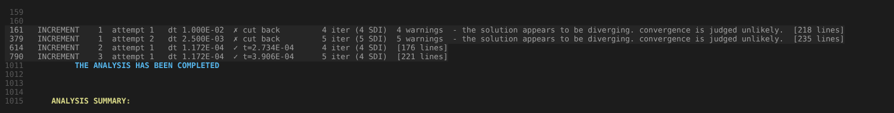
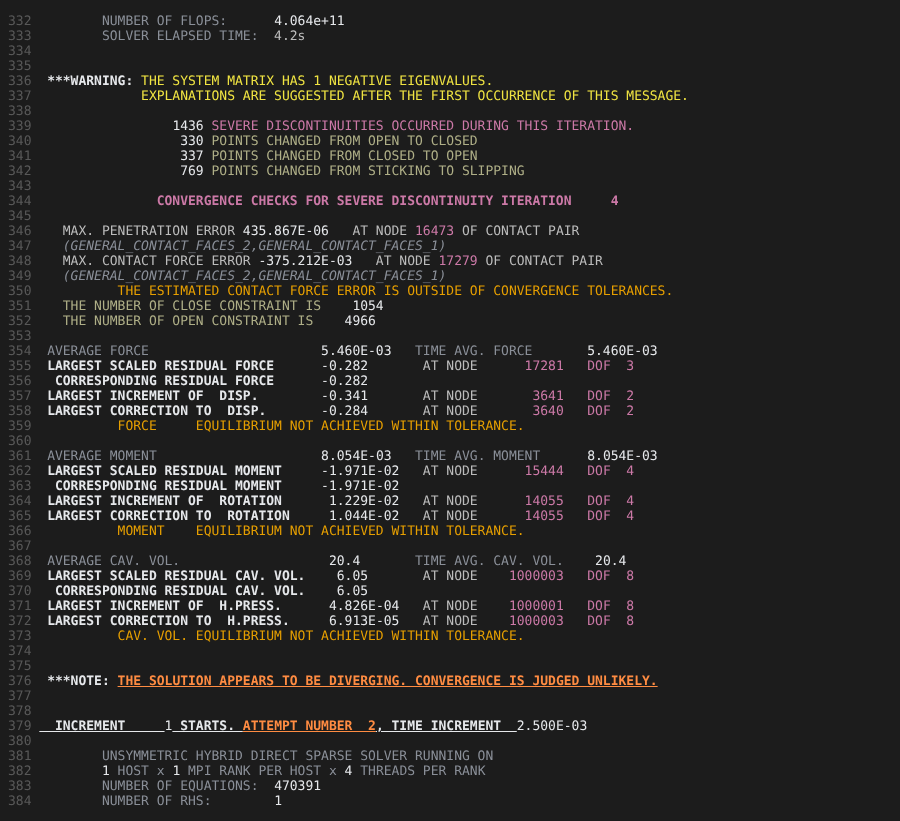

# vim-abaqusmsg

Vim support for Abaqus/Standard message files (`.msg`): convergence highlighting, one fold per increment attempt,
and jumps to cutbacks, failed checks and warnings.





## Install

The plugin needs Vim 8.0 or newer, with `filetype plugin on` and `syntax on` in your vimrc.

**vim-plug**

```vim
Plug 'bilalchrome/vim-abaqusmsg'
```

**Git**

```sh
# Windows
git clone https://github.com/bilalchrome/vim-abaqusmsg $HOME/vimfiles/pack/abaqus/start/vim-abaqusmsg
# Linux / macOS
git clone https://github.com/bilalchrome/vim-abaqusmsg ~/.vim/pack/abaqus/start/vim-abaqusmsg
# Linux / macOS, if your vimrc is ~/.config/vim/vimrc (and there is no ~/.vimrc or ~/.vim/vimrc)
git clone https://github.com/bilalchrome/vim-abaqusmsg ~/.config/vim/pack/abaqus/start/vim-abaqusmsg
```

Then run `:helptags ALL` in Vim.

**No Git:** download the ZIP, unzip it, and run `install.bat` (Windows) or `sh install.sh` (Linux/macOS).

**Notepad++:** see [`notepad++/`](notepad++/).

## Usage

| Keys / command | Does |
|---|---|
| `zo` `zc` `zR` `zM` | open and close folds |
| `]]` `[[` | next / previous increment attempt |
| `]a` `[a` | next / previous cutback |
| `]x` `[x` | next / previous failed check |
| `]d` `[d` | next / previous divergence message |
| `]w` `[w` | next / previous warning or error |
| `:AbaqusIncrements` | list of all attempts |
| `:AbaqusProblems` | list of errors, warnings and cutbacks |
| `:AbaqusHotspots` | nodes that limit convergence, worst first |
| `:AbaqusFollow` | follow a running job |

Add `let g:abaqusmsg_palette = 'okabe'` to your vimrc for colourblind-safe colours.

Full documentation: `:help abaqusmsg`.

## Troubleshooting

If `:set ft?` doesn't show `abaqusmsg`, remove any `*.msg` autocommands from your vimrc.

## License

GPL-3.0 (see [LICENSE](LICENSE))
